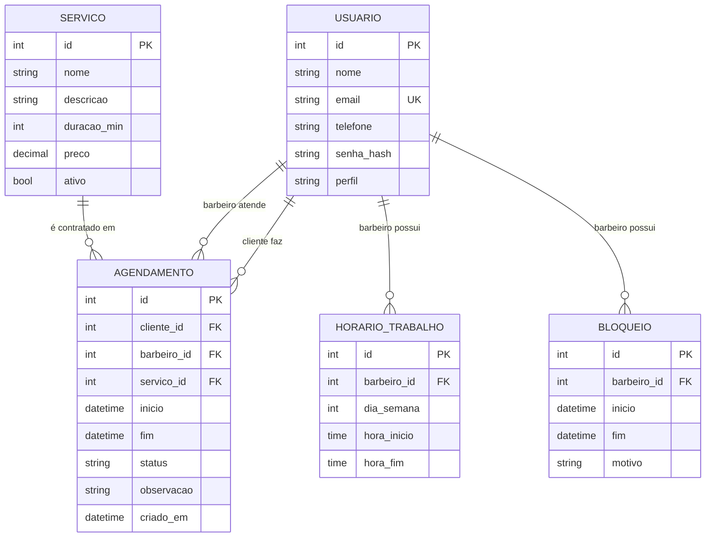

# Modelo de dados

## Diagrama ER

## Dicionário de dados

### Usuario
| Campo | Tipo | Obrigatório | Observação |
|---|---|---|---|
| id | Integer | Sim | PK |
| nome | String(100) | Sim | |
| email | String(120) | Sim | Único |
| telefone | String(20) | Não | |
| senha_hash | String(255) | Sim | Nunca armazenar senha em texto puro |
| perfil | String(20) | Sim | `cliente`, `barbeiro` ou `admin` |

### Servico
| Campo | Tipo | Obrigatório | Observação |
|---|---|---|---|
| id | Integer | Sim | PK |
| nome | String(80) | Sim | |
| descricao | String(255) | Não | |
| duracao_min | Integer | Sim | Usado em RN02 |
| preco | Numeric(8,2) | Sim | |
| ativo | Boolean | Sim | Padrão `true` |

### HorarioTrabalho
| Campo | Tipo | Obrigatório | Observação |
|---|---|---|---|
| barbeiro_id | FK Usuario | Sim | |
| dia_semana | Integer | Sim | 0 = segunda ... 6 = domingo |
| hora_inicio / hora_fim | Time | Sim | |

### Bloqueio
| Campo | Tipo | Obrigatório | Observação |
|---|---|---|---|
| barbeiro_id | FK Usuario | Sim | |
| inicio / fim | DateTime | Sim | |
| motivo | String(100) | Não | Almoço, folga etc. |

### Agendamento
| Campo | Tipo | Obrigatório | Observação |
|---|---|---|---|
| cliente_id | FK Usuario | Sim | |
| barbeiro_id | FK Usuario | Sim | |
| servico_id | FK Servico | Sim | |
| inicio | DateTime | Sim | |
| fim | DateTime | Sim | `inicio + duracao_min` (RN02) |
| status | String(20) | Sim | `PENDENTE`, `CONFIRMADO`, `CONCLUIDO`, `CANCELADO`, `FALTOU` |
| observacao | String(255) | Não | |
| criado_em | DateTime | Sim | |

## Decisões e observações

- **Barbeiro como perfil de Usuario:** evita uma tabela separada no MVP. Se surgirem dados exclusivos (comissão, especialidades), criar a tabela `Barbeiro`.
- **Conflito de horário:** verificado em código (`horario_disponivel`) com a condição `inicio_existente < fim_novo AND fim_existente > inicio_novo`. Fazer a verificação e o `INSERT` na mesma transação.
- **Datas:** armazenar em UTC e converter para o fuso local (America/Fortaleza) na exibição.
- **Exclusão:** preferir inativar (`ativo = false`) a apagar serviços e barbeiros com histórico.
