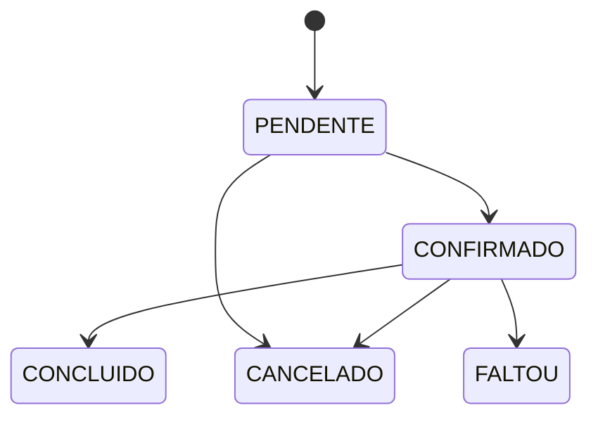

# Regras de negócio

| ID | Regra | Relacionada a |
|---|---|---|
| RN01 | Agendamentos só podem ser feitos dentro do horário de trabalho do barbeiro e fora de bloqueios | RF03, RF09 |
| RN02 | O fim do agendamento é calculado como `início + duração do serviço` | RF03 |
| RN03 | O cliente pode cancelar até **X horas** antes do horário (valor a definir, sugestão: 2 h) | RF05 |
| RN04 | Um barbeiro não pode ter agendamentos sobrepostos; um cliente também não | RF04 |
| RN05 | Antecedência máxima para agendar: **30 dias** (configurável) | RF03 |
| RN06 | Antecedência mínima para agendar: **30 minutos** (configurável) | RF03 |
| RN07 | Apenas agendamentos com status PENDENTE ou CONFIRMADO ocupam o horário | RF04 |
| RN08 | Após **N faltas**, novos agendamentos do cliente podem exigir confirmação (opcional) | RF12 |

## Status do agendamento

## Pontos a definir com o dono da barbearia

- [ ] Prazo mínimo de cancelamento (RN03)
- [ ] O agendamento nasce como PENDENTE ou já CONFIRMADO?
- [ ] Intervalo entre atendimentos (ex.: 5 min de limpeza)?
- [ ] Antecedência máxima e mínima (RN05, RN06)
- [ ] Política para faltas (RN08)
